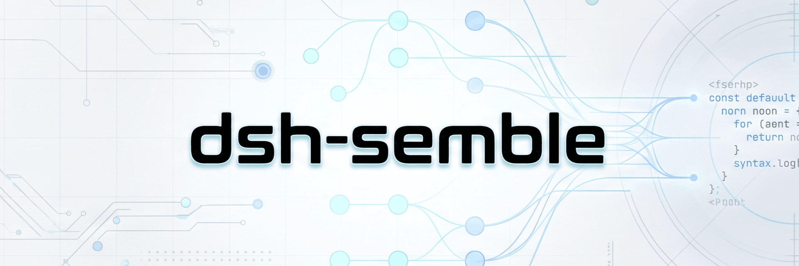

<p align="center">
  
</p>

<h1 align="center">dsh-semble</h1>

<p align="center">
  <a href="https://awesome-dsh-plugin.com"></a>
  <a href="https://dsh-plugin.org/plugins/codeintegrity/dsh-semble"></a>
  <a href="LICENSE"></a>
  <a href="https://www.npmjs.com/package/dsh-semble"></a>
  <a href="https://github.com/CodeIntegrity/dsh-semble/actions/workflows/ci.yml"></a>
  <a href="https://github.com/CodeIntegrity/dsh-semble/stargazers"></a>
  <a href="https://github.com/CodeIntegrity/dsh-semble/commits/main"></a>
  <a href="https://github.com/topics/dsh-plugin"></a>
  <a href="#平台差异"></a>
  <a href="https://github.com/CodeIntegrity/dsh-semble/blob/main/package.json">=24.9"></a>
  <a href="#兼容性">=0.2.1-rc.2"></a>
</p>

<p align="center"><a href="README.md">English</a> | 简体中文</p>

> **按行为提问，别猜文件名。** `dsh-semble` 给 agent 两个原生工具——`semble_search` 与
> `semble_find_related`——通过描述代码「做什么」来找到它。agent 不再猜一个文件名然后去 grep，而是问
> 「请求失败时重试策略在哪生效」，拿回按相关度排序的 `file:line` 命中与片段。上游 benchmark 测得比
> grep + 整读文件省约 **99% 的 token**，检索质量与代码专用的 transformer 检索模型持平——数据来自
> [Semble 项目](https://github.com/MinishLab/semble#benchmarks)，非本插件实测。全程 CPU 本地
> 运行——不需要 API key、GPU 或外部服务。

**一分钟上手：** PATH 上装好 [uv](https://docs.astral.sh/uv/) → 在**设置 → 插件 → 安装**里装
`dsh-semble` → 重启 DSH 一次 → 向 agent 提一个「X 在哪儿/怎么工作」的问题。首次调用会下载包与嵌入
模型（约 1–2 分钟），之后全部本地完成。详见[安装](#安装)。

## 目录

- [你会得到什么](#你会得到什么)
- [工具怎么用](#工具怎么用)
- [安装](#安装)
- [设置](#设置)
- [调优](#调优)
- [命令](#命令)
- [平台差异](#平台差异)
- [内置 skill](#内置-skill)
- [bundle 装配](#bundle-装配)
- [更新](#更新)
- [兼容性](#兼容性)
- [卸载](#卸载)
- [常见问题](#常见问题)
- [开发](#开发)
- [发布](#发布)
- [许可](#许可)

## 你会得到什么

| 工具 | 交给它 | 拿回来 |
| --- | --- | --- |
| `semble_search` | 一句话描述代码做什么、或者它在哪儿 | 按相关度排序的 `file:line` 命中 + 片段 |
| `semble_find_related` | 一个你已经知道的位置 | 它的邻居：其他实现、调用方、测试 |

另外还注册了一个 slash command：`/semble savings`、`/semble file-types`、`/semble version` 和
`/semble clear <index|savings|orphans|all>`，用来跑工具没有暴露的 CLI 报表，见[命令](#命令)。

一次典型对话：

> **你：** DSH 判断「插件已加载」是在哪儿决定的？
>
> **agent：** 调 `semble_search`，拿到插件清单模块的一条命中，用 `read` 打开，找到 `isEntryLoaded`
> 把 loader 条目名和包名做比对，然后**基于源码**回答，而不是基于猜测。

### 实现原理

Semble 先用 tree-sitter 把每个文件切成代码感知的分块，检索时叠加两套互补信号：静态 Model2Vec
嵌入（代码专用模型 `potion-code-16M-v2`）负责语义相似度，BM25 负责标识符与 API 名的词法命中；
两份结果用 Reciprocal Rank Fusion（RRF）融合，再按代码感知的规则重排——定义了查询符号的分块排在
只提到它的前面，查询词在分块内以标识符词干出现（`parse config` → `parseConfig` /
`config_parser`）会被加分，同一文件多个分块命中会提升整个文件，而测试文件、示例与兼容垫片被降权，
让正式的实现先冒出来。嵌入模型是静态的，查询时没有 transformer 前向计算，所以据同一份上游 benchmark，
给普通仓库建索引不到一秒、每次查询只需毫秒，全程 CPU。索引首次使用时写入磁盘缓存，之后随文件改动
增量刷新；`https://` 仓库按需 clone 进同一份缓存。

**开始前须知。** 本插件运行时依赖 PATH 上的 `uvx`；首次调用需要联网——它会从 PyPI 安装
`semble[mcp]`，再从 huggingface.co 下载 `potion-code-16M-v2` 模型，之后索引与查询都在本地完成。
无法访问 huggingface.co 的内网环境，请先把 `HF_ENDPOINT` 指向可用的镜像站。

## 工具怎么用

- `query` / `path` + `line` —— `semble_search` 传一句行为描述；`semble_find_related` 传已知的
  `file:line`（行号从 1 开始，路径照检索结果原样填）。
- `repo` —— **首次调用必填**（除非设了 `defaultRepo`）。仓库绝对路径，或 `https://` git 地址；
  传数组可同时检索多个仓库。任何一次调用指定了**单个**仓库后，后续调用可以省略 `repo` 自动复用；
  多仓库调用不会被记住，否则复用其中某一个会悄悄缩小下次检索范围。见[设置](#设置)与
  [检索多个仓库](#检索多个仓库)。
- `top_k` —— 结果数量，范围 **1–100**，默认 5；首轮没命中时提到 10–20。
- `max_snippet_lines` —— 默认 10，`0` 只返回位置。
- `content` —— 内容类型**数组**：`code`（默认）、`docs`、`config`、`all`；传 `["all"]` 可把文档和
  配置也纳入索引。传多个值时会自动去重。

某个仓库的首次查询要建索引（慢，一次性），之后复用。命中按相似度排序；检索分数是排名融合值，
即使命中的正是相关代码也只有 `0.0x` 量级——把它当**相对排序**看，不要当绝对置信度。空结果才是
「没检索到相关内容」的信号。

## 安装

### 桌面端

**设置 → 插件 → 安装**，粘贴：

```
dsh-semble
```

钉住版本写 `dsh-semble@3.2.0`。`desktop` profile 只支持从设置页安装——CLI 会拒绝，
因为这个 profile 的 `node_modules` 与 lockfile 由 Electron 应用独占。

### 命令行

```sh
dsh plugin --profile web add dsh-semble
```

该子命令在 profile 目录里跑 `pnpm add`，随后 reconcile `dsh.profile.bundles`，所以下次启动即挂载。
没有构建步骤，pnpm 不需要 `allowBuilds` 例外。

### 从源码安装

要跟 `main`、装某个 fork 或装还没发版的提交，走仓库安装：

```sh
dsh plugin --profile web add github:CodeIntegrity/dsh-semble
```

支持 `github:owner/repo`、`git+https://…`、`https://github.com/owner/repo` 和 `.tgz` 链接；
这些需要 PATH 上有 `git`。

### 本地目录

```sh
dsh plugin --profile web add link:/绝对路径/dsh-semble   # macOS / Linux
dsh plugin --profile web add link:D:\path\to\dsh-semble  # Windows
```

之后 profile 指向你的工作副本，改完 `cordis.patch.yml` 下次启动即生效，无需重装。

### 前置条件

PATH 上要有 [uv](https://docs.astral.sh/uv/)——`uvx` 负责从 PyPI 拉起 Semble。宿主要求 Node.js
`>=24.9`（见[兼容性](#兼容性)）。

```powershell
winget install astral-sh.uv                      # Windows
```

```sh
brew install uv                                  # macOS
curl -LsSf https://astral.sh/uv/install.sh | sh  # macOS / Linux
```

首次启动会下载包与嵌入模型（约 1–2 分钟，一次性，之后离线可用）。装完重启一次 DSH；在那之前设置页那行
可能显示「待重启」。

## 设置

在 **设置 → 插件** 里编辑本插件的行（loader 行的 `config`，由插件在每次调用时读取）：

| 字段 | 默认值 | 什么时候改 |
| --- | --- | --- |
| `command` / `args` | `uvx` / `--from 'semble[mcp]' semble` | 只装了 `.cmd` 包装时把 `command` 指向 `uvx.exe`；在 `args` 里写 `semble[mcp]==X.Y.Z` 可钉版本。**工具和 `/semble` 共用这组启动参数。** 要检索文档/配置请传 `content: ["all"]` 或设 `defaultContent`，不要往 `args` 追加 CLI 参数 |
| `toolTimeoutMs` | `300000` | 工具和 `/semble` 共用的调用上限；想更快失败就调小 |
| `defaultContent` | `[code]` | 工具省略 `content` 时使用的类型，例如 `[all]` 或 `[code, docs]` |
| `maxConcurrent` | `2` | 同时运行的 CLI 子进程上限；机器扛得住并行建索引时才调大 |
| `defaultRepo` | 未设 | **首次**省略 `repo` 时使用的绝对路径；任何单仓库调用之后会自动复用上次的仓库 |
| `env` | 空 | 受限网络加 `HF_ENDPOINT`；搬索引加 `SEMBLE_CACHE_LOCATION`；工具和 `/semble` 都会用到 |

改设置会重新应用插件（重注册工具和命令）；磁盘上的索引缓存不受影响。类型不对的值过不了校验，
该行会直接加载失败——改回正确值再重新应用即可。

## 调优

Semble 从**运行它的进程**的环境变量读配置。把覆盖值写在插件 `config` 的 `env` 里即可；检索工具和
`/semble` 现在走同一个 runner，会看到同一份 `SEMBLE_*` 配置，不需要在两处分别设置。

| 变量 | 默认值 | 作用 |
| --- | --- | --- |
| `SEMBLE_INDEX_WORKERS` | `4` | 首次建索引时切块用的工作进程数；`0` 表示在主进程里做。多核机器可调大，不想让后台检索吃满 CPU 就调小 |
| `SEMBLE_MCP_IDLE_TIMEOUT` | `0`（永不过期） | MCP server 模式下空闲索引在内存缓存里保留多少秒；CLI 每调用即退出，此变量对它无效 |
| `SEMBLE_MODEL_NAME` | `minishlab/potion-code-16M-v2` | 换一个 Model2Vec 嵌入模型：本地路径或 Hugging Face 仓库 |
| `SEMBLE_MAX_FILE_BYTES` | `1000000` | 超过这个大小的文件跳过；生成代码也想进索引就调大 |
| `SEMBLE_CLONE_TIMEOUT` | `60` | clone `https://` 仓库的超时秒数 |
| `HF_ENDPOINT` | `https://huggingface.co` | 一次性模型下载走的镜像 |

并发的 Semble CLI 进程由进程内的 FIFO 信号量限制（默认 **2** 个，改 `maxConcurrent` 可调整），避免并行的
工具/sub-agent 调用在 `uvx` 环境准备、索引锁和嵌入模型内存上互相争抢。POSIX 上超时或中止会终止整棵
子进程树（先 SIGTERM，短暂宽限后 SIGKILL）；Windows 上只终止直系子进程。

### 排除文件

索引器认 `.gitignore`，另外认仓库根目录的 `.sembleignore`，用来排除「git 要留、但检索不该看」的文件：
生成的客户端、fixtures、vendored 目录。语法同 gitignore，支持取反：

```gitignore
# .sembleignore
packages/client/generated/
test/fixtures/
*.min.js
!*.proto          # 把被 .gitignore 排除的文件强行拉回索引
```

只对某一个仓库成立的规则就留在那个仓库的 `.sembleignore` 里，别塞进插件设置。

### 检索多个仓库

`repo` 接受数组，所以一次调用就能把服务端和它依赖的公共库放在一起比：

```json
{ "query": "重试策略在哪儿生效", "repo": ["D:\\work\\service", "D:\\work\\shared"] }
```

git 地址同理，首次会 clone 进缓存。每个仓库各有一份索引；传数组时，每个仓库各付一次首次建索引的成本。
命中路径按仓库加了前缀，输出还会多一行 `Sources: <标签> → <源路径>`：git 地址的标签只是个名字，
要按这一行给出的路径去打开命中文件。多仓库调用不会被记住为下次调用的默认值（见[工具怎么用](#工具怎么用)）。

## 命令

两个工具只覆盖检索；Semble 的报表与缓存维护子命令只存在于 CLI。bundle 为它们注册了 `/semble`：

| 命令 | 输出 |
| --- | --- |
| `/semble savings` | 用片段代替整文件省下的 token，按时间区间和调用类型分列 |
| `/semble file-types` | Semble 会索引的扩展名，按内容类型分组的 JSON |
| `/semble version` | `uvx` 解析到的 Semble 版本——最快的安装自检 |
| `/semble clear index` | 清掉索引缓存；下一次检索会重新建索引 |
| `/semble clear orphans` | 只删除源路径已不存在的索引（适合在 DSH 清理归档的 git worktree 后使用） |
| `/semble clear savings` | 重置 token 节省统计 |
| `/semble clear all` | 以上全部 |

所有命令都在宿主进程里跑：不进模型、不弹审批，输出就是 CLI 原文（已关闭颜色）。用的是同一份
`uvx --from "semble[mcp]" semble` 安装，所以检索工具能用的地方它就能用。

`savings` 读的是 Semble 写的缓存，因此只统计同一个 `SEMBLE_CACHE_LOCATION` 下的检索。清缓存也可
回终端执行：`uvx --from "semble[mcp]" semble clear index`。

`clear` 必须显式带目标词：只敲 `/semble clear` 或目标拼错时只显示用法，不会删任何东西。清索引是
安全的（下次检索自动重建），但不清费——`clear index` / `clear all` 之后的第一次检索要从头建索引。
`/semble` 故意不做检索捷径——那是两个工具的事。只敲 `/semble` 会显示用法。

## 平台差异

bundle 不含任何 OS 专属路径、也不含区域专属 endpoint，一份安装三平台通用。真正不同的只有你敲进去的东西：

| 关注点 | Windows | macOS / Linux |
| --- | --- | --- |
| 可执行文件 | `uvx.exe`，经 PATH 解析 | `uvx` |
| 仓库路径 | `D:\work\repo` | `/home/me/repo` |
| profile 目录 | `C:\Users\<你>\.dsh` | `~/.dsh` |
| 命中路径分隔符 | 保留 `\` | POSIX `/` |

## 内置 skill

安装同时注册一个路由 skill：`semble-code-search`。工具本身不会说明「什么时候值得用」，而先摸
`grep` 的模型永远不会发现索引的存在。

DSH 的 skill 惰性加载：

| 时机 | 进入会话的内容 | 成本 |
| --- | --- | --- |
| 首次请求前 | 一条目录条目（名称 + 截断描述） | 每会话几百字节 |
| 模型调 `skill` | 完整 `skills/semble/SKILL.md` 正文 | 约 2 KB，只在实际用到时 |
| 你输入 `/semble-code-search` | 同一份正文，注入当步 | 手动 |

`/semble-code-search` 注入的是**说明**：真正的检索仍然走两个原生工具。可执行的命令是 `/semble`
（见[命令](#命令)），它在宿主里跑 CLI 报表，不花模型 token。

正文不进系统提示词。只想保留工具、不要 skill，删掉 `lib/index.js` 里的 `ctx.skills.register(...)`
代码块即可；`/semble` 是单独注册的，不受影响。

## bundle 装配

bundle 只插入一行 loader：`semble-anchor` —— 以本包名加载的本插件。DSH 判断「已加载」是拿 loader
条目名和已安装包名做匹配，这一行同时就是插件的加载入口：它的 `config` 由插件读取，成为两个工具的
启动器设置（`command` / `args` / `toolTimeoutMs` / `env`）。

Semble 本体**不做 vendored 内嵌**。插件只声明如何从 PyPI 拉起它，且用浮动版本号，所以上游的 bugfix
与新 CLI 旗标在下次调用时生效；只有 CLI 表面发生破坏性变更时才需要改这里。

## 更新

用更新的版本重跑安装，或在设置页点「更新」：

```sh
dsh plugin --profile web add dsh-semble@3.2.0
```

源码安装则换 ref 重跑，例如
`dsh plugin --profile web add github:CodeIntegrity/dsh-semble#v3.2.0`。

## 兼容性

本包遵循 semver。3.x 保持稳定的公开表面：

- 两个原生工具 `semble_search` 与 `semble_find_related`（其行为跟随 uvx 解析到的
  PyPI `semble` 版本——插件不做 pin，见「bundle 装配」）；
- 插件入口：`dsh-semble` 的 default export 与具名 `apply`，接收 `(ctx, config)`——`config` 是
  loader 行的 `config`，插件自行兜默认值；上下文带 `skills`、可选 `inject`/`tools`/`commands`；
- `/semble` 的子命令白名单（`savings`、`file-types`、`version`、`clear`）与返回结构
  （`{ kind: 'success' | 'error', text }`）；
- 插件设置字段 `command`、`args`、`toolTimeoutMs`、`defaultRepo`、`defaultContent`、
  `maxConcurrent`、`env`，以及导出的 Standard Schema `Config`；
- 导出项 `./locale/*.json`、`./icon` 与 `./package.json`。

不在承诺范围内：`cordis.patch.yml` 内部的行 id 与启动细节（那是宿主接线，不是 API）、路由 skill
的名称与正文，以及 `lib/` 中除入口外的一切——测试会 import `parseSembleArgs`/`runSemble`，但下游
包不应依赖。`engines` 的默认要求（`node >=24.9` 与 `dsh >=0.2.1-rc.2`）在一个大版本内只放宽不收紧；
提高最低版本最多算 minor，因为安装经由包管理器解析。

**2.x → 3.0.0**：MCP 桥被移除，工具名从 `mcp__semble__search` / `mcp__semble__find_related` 改为
`semble_search` / `semble_find_related`，设置字段 `toolCallTimeoutMs` 更名为 `toolTimeoutMs`。
旧名不再注册；对旧名有脚本化依赖的话需要更新。升级后重启一次 DSH。

**3.0.0 → 3.0.1**：修复 3.0.0 在真机上的加载失败——默认导出未携带 `inject` 声明，加载器读不到
skill 依赖，插件行报「异常」且工具不出现（2.x 的锚点行其实也受同一缺陷影响，只是当时 MCP 行在
承担实际工作）。3.0.1 无 API 变化，从 3.0.0 直接更新即可。

**3.0.1 → 3.0.2**：`/semble` 新增 `clear` 子命令（`index` / `savings` / `orphans` / `all`），
会话内即可清索引缓存；必须显式带目标词，裸敲 `/semble clear` 只显示用法。

**3.0.2 → 3.0.3**：仅文档——路由 skill 的「工具缺失」一节现在点明 CLI 启动失败的常见原因
（宿主 PATH 上缺 `uv`）与 Windows `uvx.cmd` 包装的规避方法，排障闭环留在 skill 内而不必翻
README。无代码改动。

**3.0.3 → 3.0.4**：与 DSH 0.2.2-alpha.2 对齐引擎声明，把 `engines.node` 从 `>=22` 提到
`>=24.9`、`@types/node` 从 `^22` 提到 `^24`。无运行时代码改动。

**3.0.4 → 3.0.5**：跟踪上游 `semble` 0.7.3 但不 pin。`semble_search` 输出末尾新增来自上游
`repos` 映射的 `Sources: <标签> → <源路径>` 行——这正是 git 地址命中能被打开的关键。CLI 契约
其余部分不变。

**3.0.5 → 3.0.6**：用零依赖 FIFO 信号量把并发 CLI 子进程限制在 2 个；给子进程设
`PYTHONUTF8=1` / `PYTHONIOENCODING=utf-8`，让 Windows 重定向输出写 UTF-8；并记录
`/semble clear orphans` 在清理 git worktree 后的用法。

**3.0.6 → 3.1.0**：单仓库调用会被记住，后续调用可省略 `repo`（多仓库调用不会）；新增
`defaultRepo` 设置兜住首次无仓库调用。超时/中止现在在 POSIX 上终止整棵子进程树（SIGTERM →
SIGKILL，Windows 仍只杀直系子进程）。skill 与两个工具的说明现在会把行为类问题先导向工具，
而不是先猜 grep 关键词。

**3.1.0 → 3.1.1**：把 `pnpm-lock.yaml` 纳入提交，让 pnpm 用户解析到与 CI 相同的开发依赖版本，
并在 `.gitignore` 里忽略 `test` 路径。无 API 变化。

**3.1.1 → 3.2.0**：新增 `defaultContent` 与 `maxConcurrent` 设置；`/semble` 现在使用插件的
`command` / `args` / `env` / `toolTimeoutMs` 设置，所以 Windows 的 `uvx.exe` 修正与缓存目录覆盖对报表
和检索同时生效。CI 与发布迁移到 Node `24.9`。导出的 `Config` schema 现在会把不合法的字段报成 issues，
不再静默放行；issue 会让该行拒绝加载，所以设置里的笔误表现为插件行失败，而不是悄悄退回默认值。
无破坏性 API 变化：两个工具、`/semble` 白名单与入口签名都不变，省略的新设置保持默认值。

## 卸载

**设置 → 插件 → 卸载**，或：

```sh
dsh plugin --profile web remove dsh-semble
```

装过 1.x 源码版的话，先按旧名卸载：`dsh plugin --profile web remove @local/semble-mcp`。
2.0.0 起改了包名，而锚点行只认包名为 `dsh-semble` 的安装。

已缓存的索引与 HuggingFace 模型留在磁盘上，重装可复用。

## 常见问题

| 现象 | 原因 | 处理 |
| --- | --- | --- |
| 装完显示「待重启」 | 宿主在安装前已经加载了层列表 | 重启 DSH 一次 |
| 工具能用但显示「未加载」 | `cordis.patch.yml` 缺了锚点行 | 重装本版本或更新版本 |
| `semble_search` / `semble_find_related` 一直不出现 | 插件没加载（缺锚点行），或宿主没有工具注册表 | 重装后重启 DSH；输入 `/semble version` 自检 |
| 首次检索卡几分钟 | 模型一次性下载 | 等待，或设 `HF_ENDPOINT` |
| 检索报「did not finish within …」超时 | 建索引 + 下载模型超过了 `toolTimeoutMs` | 调大插件设置里的 `toolTimeoutMs`，或先用 CLI 检索热身 |
| 检索报「The Semble CLI could not be started」 | 宿主 PATH 上没有 `uvx` | 装 uv，重启 DSH；Windows 上只有 `.cmd` 包装时把 `command` 改成 `uvx.exe` |
| 大改之后检索结果偏旧 | 磁盘索引复用了「自认为没变」的文件 | `uvx --from "semble[mcp]" semble clear index` 后再检索 |
| `/semble` 答「Could not start the Semble CLI」 | 宿主 PATH 上没有 `uvx`，或 `command` 配错 | 装 uv，重启 DSH；只装了 `.cmd` 包装时把 `command` 设为 `uvx.exe` |
| `savings` 统计的调用次数偏少 | 手动跑的 CLI 与插件 runner 用了不同的 `SEMBLE_CACHE_LOCATION` | 在插件 `env` 里设 `SEMBLE_CACHE_LOCATION`，工具和 `/semble` 就会一致 |
| 安装时报 `ERR_PNPM_GIT_RESOLVE_FAILED` | 到 github.com 没有网络通路 | 改用 tarball 链接或镜像 |

## 开发

```sh
git clone https://github.com/CodeIntegrity/dsh-semble
dsh plugin --profile web add link:$(pwd)   # 之后改代码、重启 DSH
```

需要 Node.js `>=24.9`（与宿主最低版本一致）。没有构建步骤：`lib/` 是纯 ESM，`cordis.patch.yml` 直接读取。
唯一运行时依赖是 `uv`。

`npm test` 用 Node 自带的 test runner 跑测试。涉及子进程的用例用 Node 可执行文件代替 `uvx`，
所以不会下载 Semble，也不会碰你的缓存。`npm run typecheck` 以 checkJs 模式对 `lib/` 跑 `tsc`——
JSDoc 注解就是类型契约，不产出任何编译产物。

## 发布

发版由 tag 驱动，见 `.github/workflows/publish.yml`：

```sh
npm version minor          # 改 package.json 并打 vX.Y.Z tag
git push origin main --follow-tags
```

工作流会先跑测试，tag 与 `package.json` 不一致时直接失败，版本已在 registry 上则跳过发布，最后带 npm
provenance 发布。需要配一个仓库 secret：

| Secret | 内容 |
| --- | --- |
| `NPM_TOKEN` | npm 细粒度访问令牌，对 `dsh-semble` 有读写权限，并为自动化开启 2FA bypass |

provenance 要求仓库公开；私有仓库请在发布步骤去掉 `--provenance`。手动触发（`workflow_dispatch`）
默认发布当前 `package.json` 版本；勾上 *dry_run* 只跑 `npm pack --dry-run`。

## 许可

MIT
